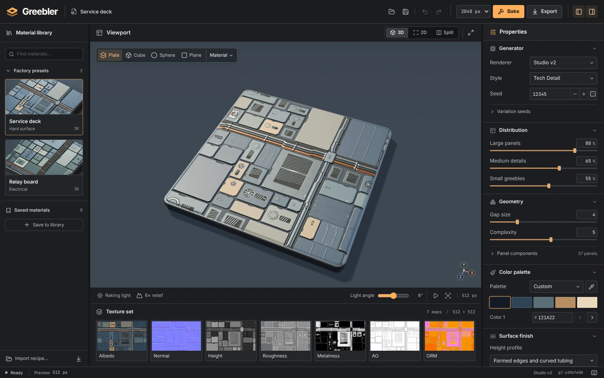
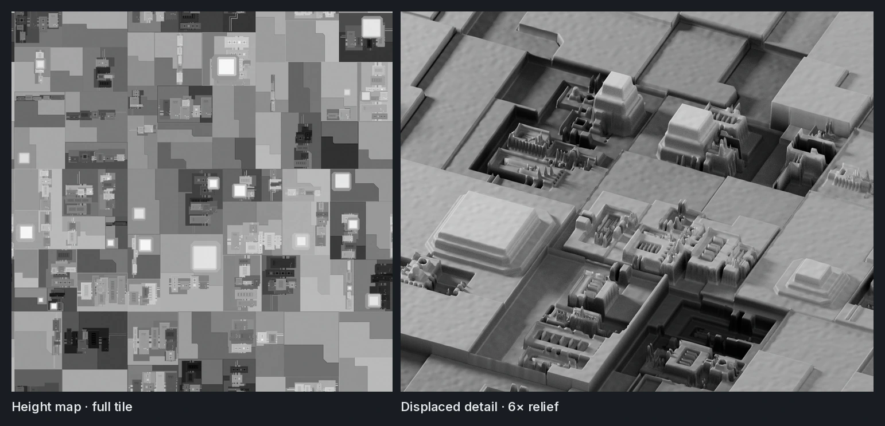
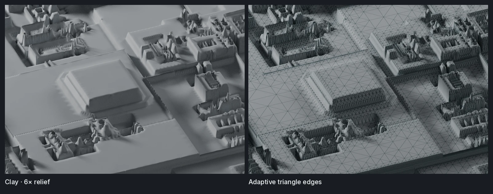
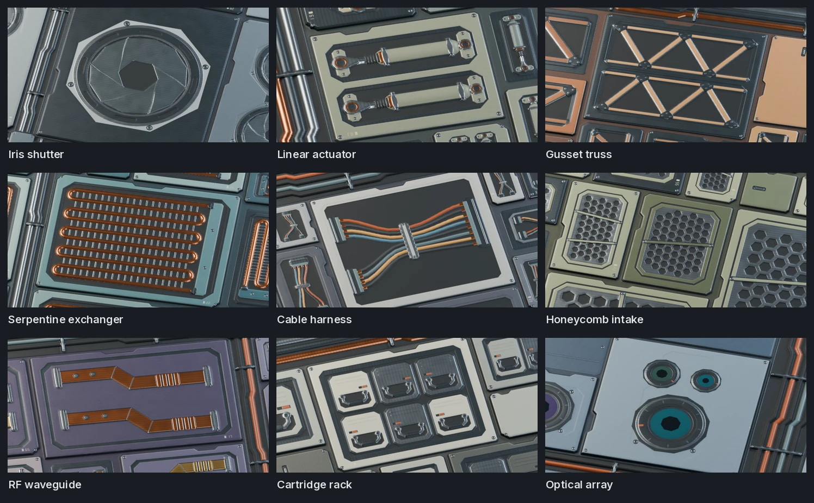
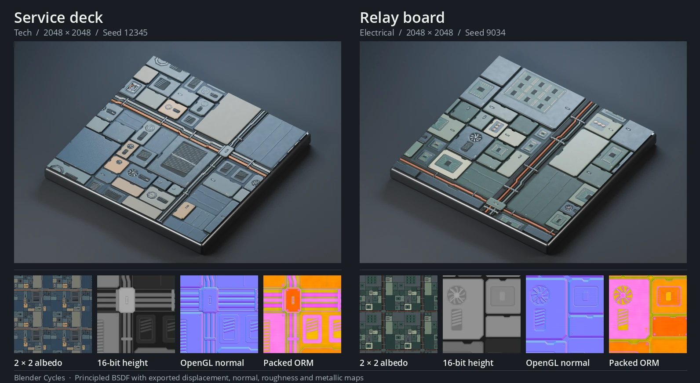

# Greebler

Greebler is a procedural hard-surface material editor. Build repeating service panels and circuit assemblies, inspect their relief under studio or raking light, and export the same material from an artist workstation or a build job. [Open the editor](https://dovvnloading.github.io/Greebler/)



## Author a material

1. Choose a factory preset in **Material library**, or open a recipe file. Each hardware preset has a matching 2048 px recipe in [examples](examples/). **Save to library** keeps a named variant in this browser. **Save recipe** downloads portable JSON.
2. In **Properties**, set the seed, panel density, gap size and surface finish. Enter an exact numeric value or drag its slider. **Variation seeds** change fitted components and finish independently. **Panel components** lets you select a bay on the tile and choose its fitted hardware. The palette accepts hex colors and supports reordering. Undo and redo are in the toolbar.
3. Orbit the specimen, sweep **Light angle**, or choose **Clay** and **Raking light** to inspect its shape. Select an axis on the orientation control to align the camera. **Frame material** restores the starting view. [Matched viewport renders](docs/viewport-comparison.webp)
4. Click a channel in **Texture set** to open the map. **Split** shows the map beside the shaded material. **2×2** reveals tile boundaries, and **1:1** lets you pan across the completed bake at native resolution. Switching back to 3D restores the camera and shading settings.
5. Choose a resolution and press **Bake**. Edits preview at up to 512 px. Bakes above 2048 px retain their full-size source maps and use a filtered 2048 px GPU preview. **Export** identifies the completed bake, offers individual PNGs and packages the chosen engine target. Canceling a bake keeps the last completed output.

Drag a divider to resize either dock. With a divider focused, the arrow keys adjust its width and Home resets it. Dock widths and visibility survive reload. On narrow screens, the Library and Properties buttons open sheets. **Shift+Space** toggles focus mode, **Ctrl/⌘ K** finds materials, and **Ctrl/⌘ Enter** bakes. The keyboard button in the status bar lists the other commands.

## Displacement

Choose **Displacement** in the material library for a classic sci-fi height field. Broad gray terraces meet at stepped joints. Recessed service strips carry traces and sockets, and a few square towers rise above the plates. Change the main seed for a new tile or the component detail seed to vary the fittings within the same layout. [Download the 2048 px recipe](examples/displacement.json)

The left image shows the repeating height tile. The raking light on the right shows how the steps and cuts read on a displaced mesh. Use the 16-bit **Height** PNG as linear, non-color data in a displacement shader.



## Sub-polygon rendering

Choose **Displacement**, bake at **2048 px**, and turn on **Sub-polygon** in the 3D viewport. Orbit to a low angle and try **Raking light** to see the raised edges and their cast shadows. The triangle count appears when the mesh is ready. **Save render** downloads a PNG of the current camera, lighting and shading at 2048 px on the long edge.

The default preview uses a regular displaced mesh and per-pixel parallax. Sub-polygon mode builds an adaptive mesh in a background worker. It measures how far a triangle would miss the height field and the area affected, then subdivides the regions that benefit most. The camera and shadow passes use the same refined vertices. All four preview shapes support the mode, and the viewport reuses the result while you orbit or relight it. The mesh uses the displayed height field, up to 2048 px. Material packages retain the selected bake resolution.



On the 2048 px **Displacement** plane (seed 3894), the adaptive mesh used 479,729 triangles. A regular grid with 480,200 triangles had 2.64% RMS height error across the source texel centers. The adaptive mesh reduced that to 1.34%, measured as a percentage of the full height range. A uniform grid with one cell per source texel would use 8,388,608 triangles.

## Hardware patterns



In Studio v2, choose **Properties → Generator → Panel pattern** to fit a pattern across a material. **Mixed hardware** chooses a pattern independently for each populated bay. **Medium details** controls how many bays receive hardware. Change **Variation seeds → Component detail** to vary the fittings within the same panel layout.

To place one part by hand, open **Geometry → Panel components**, pick a bay and choose a **Fitted component**. Select **Procedural default** to return that bay to the material’s pattern. These settings travel with the recipe through the editor, command-line bake and material exports.

| Pattern recipe | Surface detail |
| --- | --- |
| [Iris shutter](examples/iris.json) | Overlapping shutter leaves surround a variable aperture inside a slotted retaining ring. |
| [Linear actuator](examples/coupling.json) | A polished ram extends from a painted cylinder into a pinned clevis. |
| [Gusset truss](examples/truss.json) | Alternating diagonal braces meet riveted gussets above a recessed bed. |
| [Serpentine exchanger](examples/exchanger.json) | A continuous tube folds back across cooling fins and returns to its inlet header. |
| [Cable harness](examples/harness.json) | Colored leads pass under a retaining saddle and fan out into two keyed plugs. |
| [Honeycomb intake](examples/filter.json) | A chamfered frame and bridge straps protect a field of hexagonal perforations. |
| [RF waveguide](examples/waveguide.json) | Rectangular metal ducts turn through mitered elbows between bolted flanges. |
| [Cartridge rack](examples/cassette.json) | Removable sleds carry captive handles over recessed finger wells. |
| [Optical array](examples/sensor.json) | Coated primary and auxiliary optics sit in indexed focus rings on a shared mount. |

## Material data and import

| Source PNG | Encoding | Use |
| --- | --- | --- |
| Albedo | 8-bit RGB, sRGB | Base color |
| Normal | 8-bit RGB, linear | Tangent-space +Y from periodic height derivatives |
| Height | 16-bit grayscale, linear | Relative relief, black low and white high |
| Roughness | 8-bit grayscale, linear | Perceptual roughness |
| Metalness | 8-bit grayscale, linear | Metallic factor |
| AO | 8-bit grayscale, linear | Height-field occlusion sampled at two radii |
| ORM | 8-bit RGB, linear | Red occlusion, green roughness, blue metallic |

New Studio v2 recipes use the **Formed edges and curved tubing** height profile. Edges have a physical roundover, hoses have an elliptical cross-section and louver blades have a folded lip. Their tangent-space normals come from the same 16-bit height field as displacement. The coating and machined metal carry different microrelief. Loading an existing recipe retains its recorded output and ID. Choosing a different height profile creates a new recipe ID.

At unit normal strength the full displacement range corresponds to 9.765625 mm for a one-meter tile. The standard viewport preview displaces the mesh at its sampling resolution, then follows the viewing ray through the remaining height detail. Every PBR channel uses the resulting surface coordinate. Native 16-bit height values are retained at texel centers, and smaller mip levels filter complete height samples. Ambient occlusion estimates local relief at two radii and, for the formed profile, in eight directions.



These Blender Cycles renders use the included 2048 px recipes and their exported maps. The lower row shows the repeating albedo and detail crops of height, tangent-space normal and packed ORM.

| Package target | What to import |
| --- | --- |
| glTF 2.0 | Extract the archive and open `material.gltf` alongside `maps/`. It binds base color, tangent-space normals and packed metallic/roughness/occlusion on a UV swatch. Height is supplied separately. |
| Unreal Engine | Use the included DirectX normal with green flip disabled. Import ORM as Masks with sRGB disabled. Wire red to Ambient Occlusion, green to Roughness and blue to Metallic. |
| Unity HDRP | Assign base color, the +Y normal and the HDRP Mask Map to an HDRP/Lit material. Mask RGBA carries metallic, occlusion, full detail coverage and inverse roughness. Preserve the input alpha and use linear sampling. |

Every ZIP includes the source PNGs, a canonical recipe and a manifest recording pixel format, bit depth, channel bindings, relief scale and recipe ID. The engine-specific packages also include the converted texture and import instructions. [Khronos glTF material reference](https://github.com/KhronosGroup/glTF/tree/main/specification/2.0#materials) · [Unreal texture masks](https://dev.epicgames.com/documentation/en-us/unreal-engine/using-texture-masks-in-unreal-engine) · [Unity HDRP mask maps](https://docs.unity3d.com/Packages/com.unity.render-pipelines.high-definition@17.0/manual/Mask-Map-and-Detail-Map.html)

## Bake from the command line

Use Node.js 24, npm 11 or newer, and the pinned Playwright Chromium. The CLI runs the same renderer as the editor through a local loopback server. A batch validates every input and output name before starting. Completed files are published individually, so earlier bakes survive a later failure.

```bash
npm ci
npx playwright install chromium
npm run bake -- --out bakes examples/service-deck.json examples/relay-board.json
npm run bake -- --target unity-hdrp --metrics --out bakes examples/relay-board.json
npm run bake -- --target unreal --out bakes examples/service-deck.json
```

Use `--force` to replace existing outputs. Set `GREEBLER_CHROMIUM_EXECUTABLE` to use a locally installed Chromium. For repeatable pixel comparisons across machines, pin the browser and raster environment alongside the recipe. `--metrics` reports bake time, the longest gap in a 16 ms browser timer during the bake, package time, ZIP bytes and total time through disk write.

## Measured performance

Two consecutive 8192² service-deck bakes used fresh headless Chromium processes on the same Linux host. Both runs encoded all seven PNGs in a worker. The height profile was the only recipe change.

| Height profile | Bake time | PNG total | Peak sampled browser PSS | Longest UI timer interval |
| --- | ---: | ---: | ---: | ---: |
| Original raster | 34.9 s | 44.3 MiB | 498 MiB | 99 ms |
| Formed edges and curved tubing | 49.0 s | 83.1 MiB | 541 MiB | 125 ms |

The formed bake completed 2,977 callbacks on a 16 ms page timer. A separate cancellation during 8K PNG encoding settled in 1.6 ms and the next 256 px bake completed in 922 ms. These measurements cover baking, including PNG encoding. Viewport frame times depend on the graphics hardware, area and device pixel ratio. During slow orbits the viewer reduces mesh and shading cost, then restores full quality when the camera stops.

In a 1440 × 1000 browser using the SwiftShader software renderer, the formed service deck took a median 111 ms per moving frame across 16 synchronized samples. The viewer used a 464 × 242 drawing buffer during sustained slow motion and 1032 × 538 at rest. The previous default took 122 ms at 998 × 404 in the same harness. These short software runs cover the interactive quality fallback. They do not establish hardware GPU frame rates.

The following baseline uses the original raster profile, the default Tech material and seed 12345. Linux headless Chromium reported nine hardware threads. A 16 ms timer on the browser page measured how long UI callbacks went unserviced. The 4K comparison used the production editors with their previews loaded. Bake times include PNG encoding.

| Run | PNGs | Bake time | Longest gap in the UI timer |
| --- | ---: | ---: | ---: |
| Previous editor, 4096² | 5 | 2.94 s | 2.35 s |
| Studio v2 editor, 4096² | 7 | 8.36 s | 78 ms |
| Studio v2 engine, 8192² | 7 | 18.25 s | 92 ms |

Sampled peak whole-browser proportional memory at 4K was 1774 MiB for the previous editor and 986 MiB for v2. The separate 8K run isolated the production bake worker. It produced 42.09 MiB of PNGs and reached approximately 1.06 GiB of sampled whole-browser proportional memory, including a 267 MiB starting browser. These are individual runs, and timings vary with hardware and concurrent CPU load. The richer seven-map material takes longer to finish. Editing uses the lower-resolution preview and keeps the full bake off the UI thread.

## Build a Blender asset library

The Blender importer accepts a ZIP, an extracted package directory or its manifest. It creates a reusable Principled material, packs the source maps into a self-contained asset, and stores the recipe with it. Set the tile width in meters to scale its displacement. The default is one meter. The importer has been exercised by saving and reopening assets in Blender 4.3.2.

```bash
blender --background --factory-startup --python-exit-code 1 \
  --python tools/blender_material.py -- \
  bakes/greebler-tech-2048-g2-a30bfe08.zip --tile-width-m 1 --out bakes/service-deck.blend
```

Add the output directory as an asset library in Blender or append the material from the file. Replacing a previous library requires `--force`.

## Build and verify

```bash
npm run dev
npm run lint
npm run format:check
npm run typecheck
npm test
npm run test:browser
npm run build
```

The development server runs on port 3000. GitHub Actions validates pull requests and builds the Pages deployment on changes to `main`. Browser tests exercise worker cancellation, error recovery, GPU preview, cached edit equivalence, actual package downloads and Khronos validation with the exported textures. Unit tests cover recipe compatibility, tile topology, PNG encoding, real 16-bit relief and packed-channel agreement.
