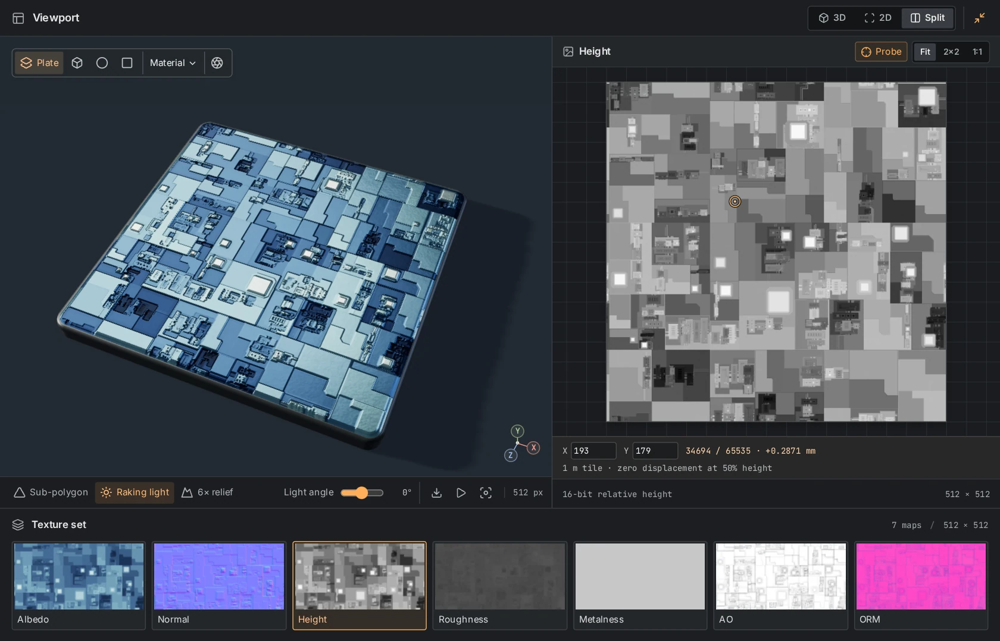

# Material authoring and delivery

Greebler already exports seven consistent PBR maps and previews displaced geometry. The following review covers the remaining steps between authoring a material and approving it for a scene.

| Artist task | Finding in the original editor | Change and acceptance check |
| --- | --- | --- |
| Distinguish maintained and neglected machinery | Edge wear chips exposed coatings. Recesses have occlusion, but the artist cannot deposit a separate finish there. | Add seeded cavity dust to Studio v2. A dust edit should alter base color, roughness and metallic response together while preserving height, normal and occlusion. Zero dust should reproduce the original recipe and bake. |
| Approve metal under the lighting of a shot | The studio and raking lights share a built-in reflection environment. They cannot reproduce a shot's lighting. | Import a local Radiance HDR panorama, rotate it at a fixed camera, and adjust exposure in stops. Returning to the studio should restore its original appearance. Lighting changes should require no material bake. |
| Verify the values a shader will receive | The map viewer supports tiling and native zoom, but visual inspection cannot distinguish adjacent 16-bit heights or verify individual packed channels. | Read a chosen source texel across maps, including native height, scaled relief, normal components and packed ORM. Repeated tiles should resolve to the same source coordinates. |
| Hand a material to a USD-based pipeline | Existing packages target glTF, Unreal and Unity HDRP. Building a USD shading network is manual. | Add an OpenUSD package with a bound, meter-scaled swatch and relative texture paths. Validate it after extraction, including color spaces, UVs, and the normal and displacement modes. |

## Verification

- **Finish.** On the 2048 px Salvage deck, moving dust from 0% to 90% changed 28.8% of albedo texels, 27.4% of roughness texels and 7.0% of metallic texels. Height, normal and occlusion matched at all 4,194,304 texels. Worker tests compare a cached dust edit with a fresh bake, then reset the finish and compare every map. Unit tests cover wrapping across tile boundaries, packed ORM agreement and recipe compatibility.
- **Lighting.** The HDR worker filters source radiance before uploading a half-float panorama of at most 1024 × 512. An 8192 × 4096 scanline-encoded test panorama produced a 4 MiB lighting texture. The browser check uses a two-color panorama at a fixed camera, changes exposure, downloads a 2048 px still and returns to the studio.
- **Inspection.** Source PNG tests distinguish adjacent 16-bit height values above the preview resolution limit. The browser test selects the same source texel in repeated tiles, switches channels and enters coordinates in the native-resolution view.
- **Delivery.** A 512 px Service deck bake was extracted and opened with OpenUSD 26.11. Both relief variants passed the 27 applicable non-USDZ validators. The editor download test compares the seven source-map hashes with the original bake.

The probe below reads a Displacement texel with a stored value of 34,694. On the one-meter swatch it sits 0.2871 mm above the midpoint.

