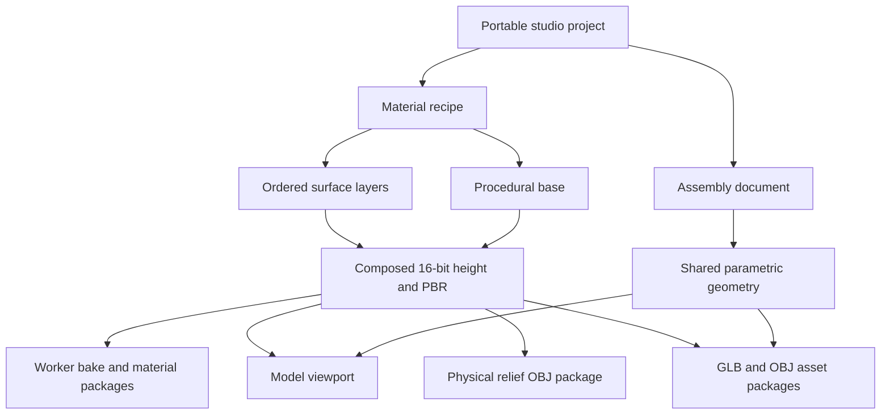

# Greebler Studio: product and engineering plan

## Product decision

Greebler should become a **procedural hard-surface kit and material authoring studio**. An artist should be able to design a readable mechanical object, give it deliberate surface detail, explore variations without destroying their decisions, and deliver an editable source plus usable geometry and PBR textures to a DCC or game engine.

The useful unit of work is an **asset**, not a random seed or a pretty specimen. The material generator remains a major strength, but the asset needs a silhouette, functional assemblies, physical dimensions, names, controllable complexity, and a dependable handoff.

This plan follows an audit of commit `322c5d3ea1dbc43cfc4de583428512aef3347a7d`. The unmodified repository passes 153 unit tests. The technical standards and external pipeline references are collected in [production-pipeline.md](production-pipeline.md).

## What the audit found

The repository already has more substance than a typical procedural texture demo:

- Versioned, deterministic material recipes with independent structure and finish seeds.
- Worker-based generation, cancellation, bounded previews, and full-resolution bakes through 8192².
- True 16-bit height, formed edges, periodic derivatives, normal maps, occlusion, metalness, roughness, and packed ORM.
- A material library, undo/redo, local persistence, map inspection, native-texel probing, HDR environments, and render export.
- Adaptive displacement visualization and specialized mechanical hardware patterns.
- glTF/OpenUSD material swatches, Unreal and HDRP packages, a Blender importer, a batch CLI, and substantial regression coverage.

The important gaps are structural:

1. **No editable geometry document.** Four fixed preview specimens are not an asset modeler. The existing material glTF is an unrelated four-vertex plane.
2. **Insufficient art direction.** Presets and seeded controls are useful for exploration, but an artist cannot explicitly place and layer their own cuts, panels, vents, or fasteners.
3. **No unified source asset.** A material recipe cannot describe an assembly's parts, dimensions, transforms, repetitions, or material assignments.
4. **No geometry production contract.** Silhouette geometry, texture detail, true relief, UV density, triangle budgets, and interchange must be explicit.
5. **The claim needs a measurable standard.** Attractive screenshots alone do not establish production utility, much less state of the art.

## Artist workflows

### Modular game-art kit

Start from an enclosure or wall-module assembly. Change its physical dimensions, bevels, panels, rails, vents, and repeated fittings. Use the generated material where it contributes fine detail; keep clean metal and painted surfaces available for visual hierarchy. Inspect wireframe and triangle count. Export the real geometry as GLB or OBJ, and continue in Blender, Maya, or the engine.

### Designed tiling material

Choose a base generator. Place authored panels, circular collars, vents, and fasteners in an ordered surface stack. Adjust position, rotation, size, repetition, operation, opacity, edge falloff, and material overrides. Check the 2×2 tile and source maps. Bake at the required resolution. Export the existing engine-specific package with the complete recipe.

### Relief and high-poly source

Use a composed 16-bit height field as a high-detail source. Export a physically scaled uniform-grid OBJ tile with optional closed backing, exact source maps and recorded sampling limits. Treat the existing adaptive preview as a visualization, and a future adaptive geometry exporter as a separate deliverable with a triangle/error budget. When relief is baked into geometry, do not apply the full height-derived normal map a second time. Keep the distinction between texture relief and mesh silhouette clear.

### Creative exploration with retained decisions

Explore factory assemblies and materials, then duplicate parts or surface layers and modify only the intended portion. Independent seeds preserve chosen structure while changing fittings or finish. Undo, portable source files, and browser autosave make exploration recoverable.

## Release architecture

### Document boundaries

Keep material recipes backward compatible. Optional surface layers belong to the recipe because they change its pixels. Geometry belongs to a separate versioned assembly document because moving a screw must not rebake a material. A portable project stores both documents together.

Canonical serialization and validation happen at document boundaries. Unknown versions, non-finite numbers, impossible dimensions, duplicate IDs, excessive counts, oversized source files, and allocation-heavy settings must be rejected before geometry or raster buffers are created.

### Shared geometry

Preview and mesh export must consume the same geometry builders. Model nodes have names, positive local dimensions, positions, rotations, bevel parameters, material assignments, and bounded repetition. Use meters and a declared material tile width. Compute real bounds and triangle counts from the resulting geometry.

Use separate parts for assembly authoring; this supports useful silhouettes and through-holes without falsely promising general Boolean CAD. Closed primitives may intersect as parts. A scene of closed solids is not automatically a single welded printable solid.

### Surface composition

Surface layers use analytic, resolution-independent masks. Ordered height operations run before normal and AO derivation. Color blending uses linear reflectance, and layer roughness/metalness overrides must remain consistent with packed ORM. Periodic sampling must preserve tiling when a layer crosses the tile boundary.

The first layer library includes raised panels, recessed cuts, elliptical bosses, rings, louver/slot patterns, and fastener arrays. Each layer supports visibility, duplication, ordering, transform, opacity, edge falloff, and repetition. The unlayered path must retain existing output.

### Handoff contract

Material packages retain the established PNG precision and engine conversions. New assembly exports add actual model geometry, named parts, UVs, normals, explicit tangent behavior, materials, physical scale, source project, and descriptive metadata. Export must identify the completed bake being used; an earlier preview must not be presented as a new full-resolution bake.

## Implementation sequence

### A. Complete in this implementation

| Workstream | Deliverable | Acceptance criterion |
| --- | --- | --- |
| Product definition | This plan and pipeline specification | Scope, decisions, tradeoffs, and later research are explicit |
| Geometry document | Strict versioned assembly and portable studio project | Save/load round trip; invalid inputs rejected before allocation |
| Geometry kernel | Editable beveled primitives, hollow part support where implemented, transforms, repetition, mirroring | Finite, consistently wound geometry; physical bounds and useful UVs |
| Model authoring | Model workspace, selection/outliner, part controls, assembly presets, grid/wireframe, stats | Artist can create, edit, duplicate, hide, delete, inspect, and export an asset |
| Source workflow | Undo/redo, autosave, save/open project | Editing and recovery work without losing material source |
| Surface engine | Ordered analytic layer stack | Height, normals, occlusion, and PBR channels agree; tiling and seed determinism preserved |
| Surface authoring | Layer presets, placement preview, transforms, material overrides, ordering | Deliberate local edits survive recipe save/open and undo |
| Mesh interchange | GLB and OBJ/MTL packages | Real authored geometry; included maps/source metadata; validator coverage |
| Relief geometry | Physically scaled uniform-grid OBJ/MTL tile, optional closed backing, exact source maps | Native 16-bit sampling; periodic boundaries; outward winding; closed-edge incidence; no doubled relief |
| Batch assets | CLI builds GLB or OBJ from portable studio projects | Whole-batch preflight; atomic per-file writes; deterministic source; no overwrite without explicit flag |
| DCC handoff gate | Real Blender imports of saved-project GLBs and a Cycles review render | Source identities, triangles, physical bounds, PNG bytes, color spaces and material bindings survive import |
| Verification | Existing regressions plus meaningful geometry, layer, package, and browser coverage | All runnable gates pass; unsupported environment checks are identified |
| Documentation | Usage, architecture, limits, future roadmap | New artist can complete a model/material/export round trip |

### B. Production hardening after the first integrated release

These are release gates to prove with representative projects and target applications, not promises attached to a button.

1. **Expand the reference asset corpus.** Build on the four supplied assembly projects with trim sheets, decal atlases, curved machinery parts, and high-detail displacement tiles. Store expected outputs and inspect them in Blender and at least one real game-engine project.
2. **Broader DCC round trips.** Extend the focused Blender import gate across more asset cases and supported application versions. Add asymmetric normal-orientation fixtures, save/reopen checks and engine import scripts after the conventions are verified.
3. **Interactive performance budgets.** Measure time to first useful preview, 95th-percentile edit latency, peak memory, GPU frame time, and cancellation response on declared machines. Use worker generation and instancing where measurements justify them.
4. **Asset-level preflight.** Detect excessive geometry, tiny bevels below texel scale, insufficient texel density, degenerate triangles, suspicious metallic values, source/bake mismatches, and oversized output. Warnings must explain an artist action.
5. **Project migrations and durability.** Explicit migrations, recovery snapshots, file-system save support where available, and stable material/part identifiers for reimport.
6. **Batch farm integration.** Build on the implemented project CLI with explicit variant manifests, platform benchmarks, output-cache identities, and a verified render/import farm environment.

### C. Differentiation toward a state-of-the-art specialist tool

Prioritize these in order of demonstrated artist value:

| Capability | Why it matters | Technical gate |
| --- | --- | --- |
| Face-aware placement and constraints | Put fittings on a selected surface with orientation, spacing, and clearance | Stable face IDs, surface frames, collision/clearance handling |
| Adaptive relief geometry export | Turn high-detail textures into useful high-poly/bake sources | Error-bounded tessellation, sealed boundaries, triangle budget, residual normal strategy |
| Trim sheets and decal atlases | Produce assets used repeatedly across a game environment | Rectangular documents, padding/dilation, region metadata, transparent/decal outputs |
| Imported stamp assets | Reuse sculpted or scanned detail | Portable binary assets, 16-bit decoding, provenance, bounded memory, channel semantics |
| Surface masks and material generators | Art-direct wear, dirt, coating, and exposed metal | Curvature/AO/thickness masks; deterministic ordering and color management |
| Non-destructive robust Booleans | Author openings and complex machine silhouettes | Robust kernel, topology validation, bevel recovery, handling of coplanar/near-degenerate cuts |
| UV and bake tools | Reduce handoff friction for low-poly assets | UV seams/packing, cage control, dilation, MikkTSpace correspondence |
| LOD and collision generation | Fit assets into runtime budgets | Error measurement, silhouette preservation, engine metadata, collision policy |
| Reusable graphs/macros | Scale procedural control to a team | Typed nodes, stable evaluation, dependency invalidation, versioned interfaces |
| USD/MaterialX and team libraries | Fit larger production pipelines | Real application compatibility tests and asset dependency resolution |

Arbitrary polygon modeling, sculpting, rigging, animation, full Substance compatibility, and general CAD tolerances are not implied by this roadmap. They require their own product decisions and validation. A focused tool that reliably creates great hard-surface kits is more useful than an unverified collection of general-purpose editing controls.

## Quality criteria

### Artist control

Every new visual operation must correspond to an editable source parameter. Important shape decisions should be local and recoverable. Presets are starting points, not the only way to author. Names, exact numeric inputs, sensible defaults, visible selection, and understandable failure messages are part of the modeling tool.

### Material correctness

Base color is sRGB; normal/height/roughness/metalness/AO/packed masks are data. Height stays 16-bit. Every derived map comes from the same final height field. Normal direction and tangent handedness are tested with asymmetric detail. ORM and HDRP packing remain exact. A shader-only preview is never described as exported geometry.

### Geometry correctness

Evaluate vertex finiteness, degenerate triangles, winding, unit normals, tangent orthogonality, UVs, bounds, positional edge incidence, repeated-instance transforms, and mesh/export parity. Assess closed primitive topology independently from assembly intersections. Primitive limits and aggregate budgets must hold for imported documents as well as UI edits.

### Performance and ownership

Do not rebake for geometry-only edits. Dispose superseded geometry and owned textures. Debounce continuous edits and group undo actions. Bound imported part counts, repetitions, subdivisions, and layer counts. Preserve the previous completed material when generation fails or is cancelled.

### Evidence

Use unit tests for numerical and serialization contracts, browser tests for actual workflow/download behavior, Khronos validation for interchange structure, and real DCC/engine imports for application compatibility. Report measured configurations and limits. Do not call a feature production-proven merely because it compiles.

## Definition of done for the integrated build

An artist can open the studio, create a meaningful multi-part asset from a factory assembly or primitives, change exact geometry and repetitions, apply a material with deliberately placed surface details, recover edits through undo and portable project files, inspect geometry cost, and download the actual asset plus PBR source. Existing material recipes and workflows continue to work. Documentation and tests describe precisely what is implemented and what remains a research or validation milestone.
